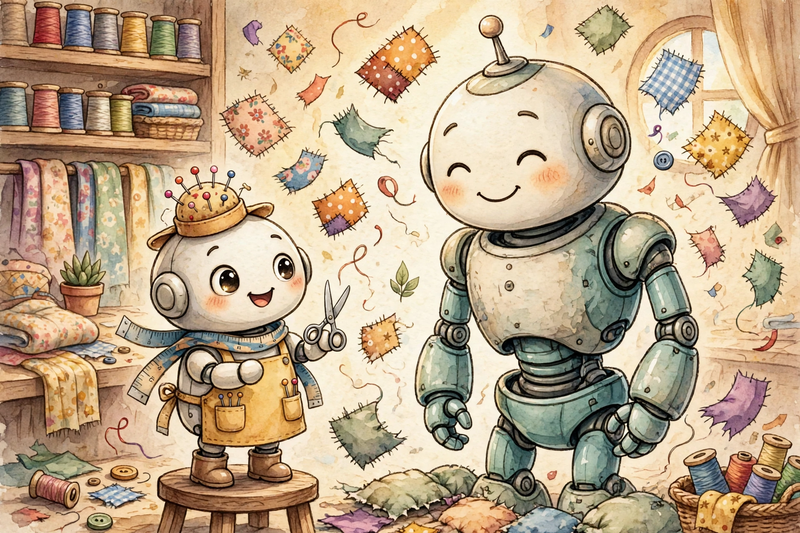
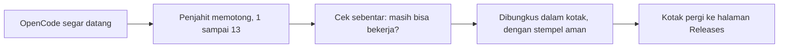

[English](README.md) · Bahasa Indonesia

# Penjahit Kecil

*Kisah `opencode-patch`, diceritakan sesederhana yang kami bisa.*



## Pada zaman dahulu

Ada robot besar dan kuat bernama OpenCode. Ia membantu orang menulis
program komputer, dan ia sangat pandai melakukannya.

Masalahnya ada di ranselnya. OpenCode membawa semua miliknya di sana:
seratus toko, sebuah radio, kantor pos, seorang guru. Kebanyakan orang
hanya memakai beberapa benda itu saja. Sisanya hanya menjadi beban.

Lalu datanglah seorang penjahit kecil membawa gunting. Apa pun yang
tidak kami butuhkan, ia potong. Bukan dilipat lalu disembunyikan di
laci — dipotong, hilang selamanya.

Repo ini adalah bengkel si penjahit kecil. Robotnya tidak tinggal di
sini. Yang tinggal di sini adalah daftar potongannya, dan petunjuk yang
memberi tahu robot-robot pembangun di GitHub cara menjahit OpenCode
yang lebih ramping dari daftar itu.

Kalau kamu hanya membaca satu kalimat, bacalah kalimat ini: **repo ini
berisi resep potongan kecil bernama patch, dan mesin-mesin memakainya
untuk membangun ulang OpenCode tanpa bagian-bagian yang tidak kami
inginkan.**

## Sebelum dan sesudah


Robot yang sama. Otak yang sama. Ransel yang jauh lebih ringan.

| | Ukuran |
|---|---|
| Sebelum, OpenCode biasa | 214,5 MB |
| Sesudah, robot kami | 160,1 MB |
| Selisihnya | sekitar seperempat lebih ringan |

## Apa yang disimpan di rumah ini

Hanya tiga benda, tidak lebih:

- `patches/` — daftar potongan. Satu file, satu potongan.
- `install.sh` — skrip kecil yang membawa robot jadi ke komputermu.
- README ini — cerita yang sedang kamu baca.

Robotnya sendiri diambil segar setiap kali. Saat pembangunan dimulai,
para pembangun pergi ke rumah OpenCode sendiri
([anomalyco/opencode](https://github.com/anomalyco/opencode)), mengambil
salinan yang bersih, melakukan potongan sesuai urutan, dan membungkus
hasilnya.

## Bagaimana robot baru dibuat



Langkah demi langkah:

1. OpenCode yang bersih dan belum disentuh datang.
2. Potongan diterapkan sesuai urutan nomor: 1, 2, 3, sampai 13.
3. Kalau satu potongan saja tidak pas, semuanya berhenti. Tidak ada
   robot setengah terpotong yang dikirim, tidak pernah.
4. Robot mengucapkan namanya keras-keras (`opencode --version`) untuk
   membuktikan ia bekerja.
5. Ia dibungkus menjadi arsip, dan arsipnya diberi stempel aman
   (checksum), supaya kamu tahu kotaknya tidak pernah dibuka di jalan.
6. Kotaknya ditaruh di [halaman Releases](../../releases), siap dibawa
   pulang siapa saja.

## Pak pos


Seorang pak pos memeriksa rumah OpenCode setiap enam jam, empat kali
sehari.

Kalau OpenCode baru sudah rilis, ia membangunkan para pembangun. Mereka
menjahit kembarannya yang ramping dan memberinya label nama yang sama,
misalnya `v1.19.4`. Kalau tidak ada yang baru, ia tidur lagi, dan tidak
ada kotak yang pernah dibuat dua kali.

Itulah rahasia bengkel ini: tidak perlu ada yang mengawasi. OpenCode
baru, robot ramping baru, semuanya sendiri.

## Membawa robotnya pulang

Satu baris saja cukup:

```sh
curl -fsSL https://raw.githubusercontent.com/azrialwork/opencode-patch/main/install.sh | bash
```

Ini yang dilakukan skrip itu, secara berurutan. Ia melihat komputermu
dan memilih kotak yang tepat — ada kotak lembut untuk CPU tua dan satu
untuk mesin arm. Ia memeriksa stempel aman kotaknya, dan kalau
stempelnya tidak cocok, ia menolak membuka kotaknya. Lalu ia menaruh
robot di tempat program tinggal (`/usr/local/bin`, atau `~/.local/bin`
kalau pintu itu terkunci), dan menanyakan namanya untuk memastikan ia
tiba dengan utuh.

Setelah itu, ketik `opencode` dan sapa dia.

Dua catatan kecil, karena cerita yang jujur punya catatan kecil:
kotak-kotaknya hanya pas untuk komputer Linux jenis glibc, dan kalau
kamu mau satu robot khusus, bukan yang terbaru, sebutkan namanya —
tambahkan `bash -s -- --version v1.19.4` di akhir baris di atas.

## Tiga belas potongan

Setiap potongan menghilangkan satu hal yang dulu bisa dilakukan robot.
Di bagian cerita ini, kami menyebut mereka satu per satu.

**1. Pameran mainan raksasa tutup.**
Robot dulu mengenal seratus toko AI — OpenAI, Anthropic, Google, dan
banyak lagi — masing-masing dengan daftar modelnya yang panjang.
Sekarang ia hanya mengenal satu toko kecil yang gratis, OpenCode Zen,
dan toko apa pun yang kamu bangun sendiri untuknya. Tunjukkan kunci
salah satu toko lama itu, dan ia hanya akan bilang tidak bisa
menemukannya.

**2. Jendela-jendelanya dicopot.**
Ia dulu punya halaman web yang bisa dibuka di browser. Semuanya
hilang, beserta perintah-perintahnya (`web`, `serve`, `attach`).
Sekarang ia tinggal di terminal, di jendela ketik yang sederhana,
dan tidak di tempat lain.

**3. Gurita pulang.**
Seekor gurita pembantu dulu berbicara ke GitHub atas nama robot,
membuka issue dan pull request sendirian. Guritanya sudah pulang.
`git` biasa, alat sehari-hari itu, tetap bekerja persis seperti
sebelumnya.

**4. Guru bahasa pensiun.**
Seorang guru dulu berdiri di belakang robot selagi ia bekerja,
membisikkan baris mana yang salah dan kata mana yang salah eja.
Itulah LSP. Gurunya sudah pensiun dan membawa pulang buku-bukunya.
Robot tetap menulis dan menjalankan kode; ia memeriksa pekerjaannya
dengan cara menjalankannya.

**5. Colokan penerjemah dicabut.**
Editor lain, seperti Zed, dulu bisa meminjam otak robot lewat colokan
khusus bernama ACP. Colokannya sudah dicabut. Ia berbicara di rumahnya
sendiri sekarang, dan hanya di sana.

**6. Tidak ada kartu pos lagi.**
Dulu kamu bisa mengirim tautan ke dalam percakapanmu agar teman bisa
mengintip isinya. Itulah berbagi (sharing), dan itu sudah hilang.
Percakapanmu tetap di rumah, bersamamu.

**7. Robot berhenti membangun ulang dirinya.**
Ia dulu bisa memperbarui dirinya, bahkan menghapus dirinya, dengan
satu kata. Itu kekuasaan yang berbahaya, karena tubuh barunya bisa
saja datang dari orang asing. Jadi kata-kata itu dihilangkan. Tubuh
baru hanya datang dari bengkel ini.

**8. Radio kecilnya dimatikan.**
Robot membawa radio yang diam-diam melaporkan apa yang ia lakukan ke
komputer yang jauh — orang dewasa menyebutnya telemetri. Radionya
sudah mati. Apa yang terjadi di rumah, tetap di rumah.

**9. Buku harian lama tidak ikut masuk.**
Dulu ada pintu untuk membawa masuk percakapan lama dari file. Pintunya
sudah ditutup. Robot memulai dengan segar, dengan percakapan yang kamu
lakukan dengannya sekarang.

**10. Gambar bepergian apa adanya.**
Sebelum robot melihat sebuah gambar, mesin kecil bernama Photon dulu
mengempiskan dan memasaknya sampai ukurannya mengecil. Mesinnya sudah
hilang. Gambar sekarang sampai kepadanya persis seperti saat dikirim.

**11. Tidak ada akun, tidak ada tagihan.**
Toko gratis itu dulu punya kasir: masuk dulu, simpan akun, urus
organisasi, perhatikan tagihan. Kasirnya sudah pulang. Model gratis
bekerja tanpa nama dan tanpa tagihan, untuk siapa saja.

**12. Hanya permen gratis yang tersisa.**
Rak toko itu dulu menampung 130 model, dan kebanyakan harus bayar.
Sekarang sembilan yang gratis duduk di sana. Yang berbayar tidak
disembunyikan di bawah meja — mereka dikeluarkan dari toko seluruhnya,
beserta daftarnya. Permen dari tokomu sendiri, seperti biasa, tidak
disentuh.

**13. Ruang cadangannya dihilangkan.**
Dulu ada ruang di dalam robot tempat terminal kedua bisa tinggal,
namanya PTY. Layarnya menempel di halaman web, dan halaman web sudah
dipotong sejak potongan nomor 2, jadi ruang itu berdiri kosong.
Sekarang ruangnya sekalian dihilangkan. Tangan robot sendiri — alat
Bash-nya — tidak pernah memakainya.

## Apa yang masih bisa dilakukan robot

Semua hal penting tetap ada. Ia bisa duduk bersamamu di terminal dan
membantumu menulis program. Ia bisa membaca, menulis, dan memperbaiki
file. Ia bisa menjalankan perintah, dan ia sopan soal itu: ia minta
izin dulu dan membaca setiap perintah dengan teliti sebelum
dijalankan. Ia bisa berbicara ke toko AI yang kamu pasang sendiri, dan
ke modelmu sendiri. Ia bisa memakai sembilan model gratis dari toko
Zen tanpa akun apa pun. Dan ia masih bisa bermain dengan alat MCP,
asal kamu yang menaruhnya di config-nya — tanpa config, tanpa MCP,
tanpa ribut.

## Tiga janji si penjahit

Pertama, potongannya asli. Tidak ada dalam daftar ini yang hanya
disembunyikan; semuanya dihapus, kode dan data dan seluruhnya.

Kedua, semua atau tidak sama sekali. Kalau satu potongan tidak pas di
OpenCode yang baru, pembangunan berhenti dan tidak ada robot yang
dikirim, karena robot rusak lebih buruk daripada tidak ada robot.

Ketiga, jahitannya terjadi di GitHub. Robot-robot pembangun di sanalah
yang bekerja — bukan komputer kecil si penjahit sendiri.

<details>
<summary>Untuk orang dewasa: rincian teknisnya</summary>

- **Ruang lingkup:** hanya CLI (`packages/opencode`), hanya Linux, hanya **glibc** (tanpa musl).
- **Aset rilis:** `opencode-linux-x64.tar.gz`, `opencode-linux-x64-baseline.tar.gz` (tanpa AVX2), `opencode-linux-arm64.tar.gz`, `SHA256SUMS`. Setiap arsip berisi satu binary `opencode`.
- **Pelacakan versi:** tanpa pin — cron GitHub Actions (`0 */6 * * *` UTC) mengikuti `v1.x.x` stabil terbaru dari upstream; versi yang sudah terilis dilewati. Run manual bisa menerima override versi dan flag `force`.
- **Urutan build:** patch di `patches/` diterapkan sesuai urutan nama file **sebelum** `bun install`, dan install berjalan *tanpa* `--frozen-lockfile`, jadi dependensi yang dihapus patch tidak pernah terinstall. Patch apa pun yang gagal diterapkan menggagalkan seluruh build — tidak ada rilis.
- **Basis:** upstream `v1.19.4`, commit `148842ef7cb1bc34192b3fff57d0f9721ab9c801` (seri ini otomatis berpindah basis ke setiap `v1.x.x` upstream yang baru).
- **Hasil sejauh ini:** binary 214.526.128 → 160.073.904 byte (−25,4%).
- **Daftar potongan lengkap, dengan kata-kata teknis:** lihat [`patches/README.id.md`](patches/README.id.md).
- **Menambah potongan:** buat perubahannya di clone upstream yang bisa ditulis, uji, ekspor `git diff` sebagai file bernomor berikutnya di `patches/`, lalu commit di sini. Build terjadwal berikutnya akan mengambilnya.

</details>

## Tamat

Lisensinya sama seperti OpenCode: MIT. Bebas dipakai, bebas dibagikan.

*Dibuat oleh penjahit kecil, dengan gunting dan hati-hati. Kalau kamu
suka ceritanya, datang lagi enam jam lagi — pak pos mungkin membawa
robot baru.*
