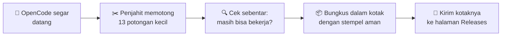

<p align="center"><a href="README.md">🇬🇧 English</a> · 🇮🇩 <b>Bahasa Indonesia</b></p>

# 🤖✂️ Penjahit Kecil

### *Kisah `opencode-patch`, diceritakan dengan bahasa paling sederhana*


---

## 📖 Bab 1 — Pada zaman dahulu…

Pada zaman dahulu, ada robot besar dan kuat bernama **OpenCode**.
Ia membantu orang membuat program komputer. Ia pintar sekali. 🤖

Tapi OpenCode membawa **semua barang** di ranselnya.
Seratus toko mainan. Sebuah radio. Kantor pos. Guru bahasa.
Padahal, kebanyakan orang hanya memakai beberapa mainannya saja.
Sisanya hanya membuat ranselnya berat. 🎒

Lalu datanglah seorang **penjahit kecil**.
Kres, kres. ✂️
Ia memotong bagian-bagian yang tidak kami butuhkan — **benar-benar dipotong**,
bukan disembunyikan di lemari. Hilang ya hilang.

Rumah ini, `opencode-patch`, adalah bengkel si penjahit kecil.
Di sini **tidak** ada robotnya.
Di sini hanya ada **daftar potongan** si penjahit, dan petunjuk untuk
robot-robot pembangun di GitHub agar mereka bisa menjahit OpenCode
yang lebih ramping, lagi dan lagi.

> 💡 **Versi satu kalimat:** repo ini berisi "resep potongan" kecil
> (namanya *patch*). Robot pembangun yang besar memakainya untuk
> membuat ulang OpenCode tanpa bagian-bagian yang tidak kami inginkan.

---

## 🎒 Bab 2 — Sebelum dan sesudah diet


Robot yang sama. Otak yang sama. Ranselnya jauh lebih ringan.

| | Seberapa besar? |
|---|---|
| 🐘 Sebelum (OpenCode biasa) | **214,5 MB** |
| 🐜 Sesudah (robot kami) | **160,1 MB** |
| 🎉 Hilang | sekitar **1 dari setiap 4 gigitan** |

---

## 🏠 Bab 3 — Apa saja isi rumah ini?

Hanya tiga benda yang tinggal di sini:

| Benda | Artinya, dengan bahasa bayi |
|---|---|
| 📋 `patches/` | Daftar potongan si penjahit. Satu file = satu potongan. |
| 🪄 `install.sh` | Mantra ajaib yang membawa robot jadi ke komputermu. |
| 📜 `README.id.md` | Buku cerita ini, yang sedang kamu baca. |

Robotnya sendiri **tidak** ada di sini.
Setiap kali membangun, robot pembangun mengambil OpenCode yang masih
segar dari rumahnya sendiri ([anomalyco/opencode](https://github.com/anomalyco/opencode)),
melakukan potongan-potongan itu, lalu membungkusnya.

---

## 🏭 Bab 4 — Bagaimana robot baru lahir



Dengan langkah bayi:

1. 🎁 OpenCode yang segar dan belum disentuh datang.
2. ✂️ Penjahit melakukan potongannya, **sesuai urutan nomor**: potongan 1, potongan 2, potongan 3…
3. 🛑 Kalau **satu potongan saja tidak pas**, semuanya berhenti. Tidak ada robot setengah terpotong. Tidak pernah.
4. 🔍 Robot mengucapkan namanya keras-keras (`opencode --version`) untuk membuktikan ia hidup.
5. 📦 Ia dibungkus dalam kotak, dan kotaknya diberi **stempel aman** (checksum).
6. 🚀 Kotaknya dikirim ke [halaman Releases](../../releases) agar siapa pun bisa membawanya pulang.

---

## ⏰ Bab 5 — Pak pos yang tidak pernah tidur terlalu lama


Seorang robot pak pos kecil memeriksa rumah OpenCode **setiap 6 jam** —
4 kali sehari, siang dan malam. 🌞🌙

- 📭 *"Ada OpenCode baru lahir?"* → Ia membangunkan para pembangun.
  Mereka menjahit kembarannya yang ramping dengan **label nama yang sama** (misalnya `v1.19.4`).
- 😴 *"Tidak ada yang baru?"* → Ia tidur lagi. Tidak ada kotak yang dibuat dua kali.

Itulah sebabnya bengkel ini tidak perlu pengasuh.
OpenCode baru, robot ramping baru — semuanya sendiri.

---

## 🪄 Bab 6 — Bawa robotnya pulang

Satu mantra ajaib. Salin, tempel, selesai:

```sh
curl -fsSL https://raw.githubusercontent.com/azrialwork/opencode-patch/main/install.sh | bash
```

Apa yang dilakukan mantra itu? Empat langkah bayi:

1. 👀 Ia melihat komputermu: *"Linux? CPU besar atau CPU tua? Arm atau x64?"*
2. 🎯 Ia memilih kotak yang tepat untuk komputermu. CPU tua mendapat kotak yang lembut (yang "baseline").
3. 🔐 Ia memeriksa **stempel aman** kotaknya. Stempelnya salah? **Ia menolak membuka kotaknya.**
4. 🏠 Ia menaruh robot di tempatnya (`/usr/local/bin`, atau `~/.local/bin` kalau pintu itu terkunci).

Lalu cukup ketik `opencode` dan sapa dia. 👋

> 🧷 Mau satu robot khusus, bukan yang terbaru? Sebutkan namanya:
> tambahkan `bash -s -- --version v1.19.4` di akhir mantra.
> Kotak-kotaknya hanya pas untuk komputer **Linux** (jenis glibc — maaf, teman-teman musl dan Windows).

---

## ✂️ Bab 7 — Kenalan dengan 13 potongan

Setiap potongan menghilangkan **satu hal yang dulu bisa dilakukan robot**.
Ini mereka, satu per satu. Tanpa kata-kata menakutkan, janji. 🤞

### 1. 🏪 Pameran mainan raksasa tutup
Dulu, robot mengenal **seratus toko AI** (OpenAI, Anthropic, Google, dan banyak lagi).
Sekarang ia hanya mengenal **satu toko kecil yang gratis** — OpenCode Zen — plus **toko apa pun yang kamu bangun sendiri**.
Kunci toko lain? Ia hanya menjawab *"tidak ditemukan."*

### 2. 🪟 Tidak ada jendela lagi
Robot dulu punya **halaman web** cantik yang bisa dibuka di browser.
Sudah hilang. Sekarang ia tinggal **hanya di terminal** — jendela ketik hitam itu.
Rumah sederhana, tidak ada jendela yang harus dibersihkan.

### 3. 🐙 Gurita pulang ke rumahnya
Dulu ada gurita pembantu yang berbicara ke **GitHub** sendiri
(membuka issue dan pull request sendirian).
Guritanya sudah pulang. `git` biasa tetap bekerja dengan baik.

### 4. 🔤 Guru bahasa pensiun
Dulu ada guru yang berdiri di belakang robot sambil berbisik
*"baris itu salah, kata itu salah eja"* (itu namanya LSP).
Gurunya sudah pensiun. Robot tetap menulis dan menjalankan kode —
ia hanya memeriksa PR-nya dengan cara menjalankannya.

### 5. 🔌 Colokan penerjemah dicabut
Editor lain (seperti Zed) dulu bisa meminjam otak robot lewat colokan khusus (ACP).
Colokannya dicabut. Sekarang robot hanya berbicara di rumahnya sendiri.

### 6. 📤 Tidak ada kartu pos lagi
Dulu kamu bisa mengirim **tautan ke percakapanmu** agar teman bisa mengintip isinya (share).
Tidak ada kartu pos lagi. Percakapanmu tetap di rumah, pribadi, bersamamu.

### 7. 🔄 Robot berhenti membangun ulang dirinya
Dulu, robot bisa **memperbarui atau menghapus dirinya** dengan satu kata.
Berbahaya! Tubuh baru dari orang asing bisa menggantikan tubuh buatan penjahit kami.
Jadi kata-kata itu dihilangkan. Tubuh baru hanya datang dari **bengkel ini**.

### 8. 📡 Radio kecilnya dimatikan
Robot dulu punya radio yang diam-diam **melaporkan apa yang ia lakukan** ke komputer yang jauh (telemetri).
Radionya dimatikan. Apa yang terjadi di rumah, tetap di rumah.

### 9. 📥 Tidak bisa mengimpor buku harian lama
Dulu ada pintu untuk **membawa masuk percakapan lama** dari file (import).
Pintunya ditutup dan kuncinya dibuang.

### 10. 🖼️ Gambar bepergian apa adanya
Gambar dulu **dikempiskan dan diubah ukurannya** oleh mesin foto kecil (Photon) sebelum robot melihatnya.
Mesinnya sudah hilang. Sekarang gambar bepergian **persis seperti aslinya**.

### 11. 🔑 Tidak ada akun, tidak ada tagihan
Toko gratis itu dulu punya **kasir**: masuk akun, organisasi, tagihan.
Kasirnya sudah pulang. Permen gratisnya ya… gratis begitu saja.
Tidak perlu masuk. Tidak ada tagihan. Selamanya.

### 12. 🍬 Hanya permen gratis yang tersisa
Toko itu dulu punya 130 permen. Kebanyakan harus bayar. 💸
Sekarang hanya **9 permen gratis** yang duduk di rak.
Yang berbayar tidak disembunyikan di bawah meja — mereka **tidak ada di toko sama sekali**.
(Permen dari *tokomu sendiri* tentu tetap bisa.)

### 13. ⌨️ Ruang ketik tambahan dihilangkan
Dulu ada ruang cadangan tempat **terminal kedua** bisa tinggal di dalam robot (PTY).
Tapi layarnya menempel di halaman web — dan halaman web sudah dipotong di Bab 7, potongan nomor 2.
Jadi ruang kosong itu sekalian dihilangkan. Tangan robot sendiri (alat Bash-nya) memang tidak pernah memakai ruang itu.

---

## ✅ Bab 8 — Apa yang MASIH bisa dilakukan robot

Jangan khawatir. Semua hal penting tetap ada: 💪

- ✅ Mengobrol denganmu di terminal, dan membantumu membuat program
- ✅ Membaca, menulis, dan memperbaiki file
- ✅ Menjalankan perintah — ia **minta izin dulu**, dan membaca setiap perintah dengan teliti sebelum menjalankannya
- ✅ Berbicara ke **toko AI milikmu sendiri** (provider custom) dan modelmu sendiri
- ✅ Memakan **9 permen gratis** dari toko Zen, tanpa perlu akun
- ✅ Bermain dengan **mainan MCP** — tapi hanya kalau *kamu* yang menaruhnya di config-nya. Tanpa config, tanpa mainan, tanpa ribut

---

## 📏 Bab 9 — Tiga janji si penjahit

1. 🤞 **Potongan asli saja.** Tidak ada yang "disembunyikan". Kalau masuk daftar potong, berarti *dihapus* — kodenya, datanya, semuanya.
2. 🛑 **Semua atau tidak sama sekali.** Kalau satu potongan tidak pas di OpenCode yang baru, pembangunan berhenti dan **tidak ada robot yang dikirim**. Robot rusak lebih buruk daripada tidak ada robot.
3. 🏭 **Bengkelnya ada di GitHub.** Robot dibangun oleh robot pembangun GitHub, tidak pernah di komputer kecil si penjahit sendiri.

---

<details>
<summary>🧓 <b>Psst… untuk orang dewasa yang mau bagian teknisnya</b> (klik aku)</summary>

- **Ruang lingkup:** hanya CLI (`packages/opencode`), hanya Linux, hanya **glibc** (tanpa musl).
- **Aset rilis:** `opencode-linux-x64.tar.gz`, `opencode-linux-x64-baseline.tar.gz` (tanpa AVX2), `opencode-linux-arm64.tar.gz`, `SHA256SUMS`. Setiap arsip berisi satu binary `opencode`.
- **Pelacakan versi:** tanpa pin — cron GitHub Actions (`0 */6 * * *` UTC) mengikuti `v1.x.x` stabil terbaru dari upstream; versi yang sudah terilis dilewati. Run manual bisa menerima override versi dan flag `force`.
- **Urutan build:** patch di `patches/` diterapkan sesuai urutan nama file **sebelum** `bun install`, dan install berjalan *tanpa* `--frozen-lockfile`, jadi dependensi yang dihapus patch tidak pernah terinstall. Patch apa pun yang gagal diterapkan menggagalkan seluruh build — tidak ada rilis.
- **Basis:** upstream `v1.19.4`, commit `148842ef7cb1bc34192b3fff57d0f9721ab9c801` (seri ini otomatis berpindah basis ke setiap `v1.x.x` upstream yang baru).
- **Hasil sejauh ini:** binary 214.526.128 → 160.073.904 byte (−25,4%).
- **Daftar potongan lengkap, dengan kata-kata teknis:** lihat [`patches/README.id.md`](patches/README.id.md).
- **Menambah potongan:** buat perubahannya di clone upstream yang bisa ditulis, uji, ekspor `git diff` sebagai file bernomor berikutnya di `patches/`, lalu commit di sini. Build terjadwal berikutnya akan mengambilnya.

</details>

---

## ⚖️ Tamat

Lisensinya sama seperti ibu OpenCode: **MIT** — bebas dipakai, bebas dibagikan.

*Dibuat dengan ✂️ dan ❤️ oleh penjahit kecil.*
*Kalau kamu suka cerita ini, datang lagi 6 jam lagi — pak pos mungkin membawa robot baru.* 📬
