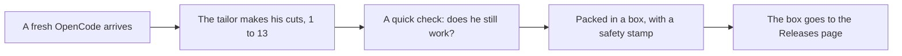

English · [Bahasa Indonesia](README.id.md)

# The Little Tailor

*The story of `opencode-patch`, told as simply as we can.*


## Once upon a time

There was a big, strong robot named OpenCode. He helps people write
computer programs, and he is very good at it.

The trouble is his backpack. OpenCode carries everything he owns in it:
a hundred shops, a radio, a post office, a teacher. Most people only
ever use a few of those things. The rest is just weight.

So a little tailor came along with a pair of scissors. Whatever we do
not need, he cuts away. Not folded up and hidden in a drawer — cut off,
gone for good.

This repository is the tailor's workshop. The robot does not live here.
What lives here is the list of cuts, and the instructions that tell
GitHub's builder robots how to sew a slimmer OpenCode from the list.

If you only read one sentence, read this one: **this repo holds small
cut recipes called patches, and machines use them to rebuild OpenCode
without the parts we do not want.**

## Before and after


Same robot. Same brain. A much lighter backpack.

| | Size |
|---|---|
| Before, plain OpenCode | 214.5 MB |
| After, our robot | 160.1 MB |
| Difference | about a quarter lighter |

## What is kept in this house

Three things, nothing more:

- `patches/` — the list of cuts. One file, one cut.
- `install.sh` — a small script that brings the finished robot to your computer.
- This README — the story you are reading.

The robot himself is fetched fresh every time. When a build starts, the
builders go to OpenCode's own home
([anomalyco/opencode](https://github.com/anomalyco/opencode)), take a
clean copy, do the cuts in order, and pack up the result.

## How a new robot is made



Step by step:

1. A clean, untouched OpenCode arrives.
2. The cuts are applied in number order: 1, 2, 3, all the way to 13.
3. If even one cut does not fit, everything stops. Nobody ships a
   half-cut robot.
4. The robot says his name out loud (`opencode --version`) to prove he
   works.
5. He is packed into an archive, and the archive gets a safety stamp
   (a checksum), so you can tell the box was never opened on the way.
6. The box is placed on the [Releases page](../../releases), ready for
   anyone to take home.

## The postman


A postman checks OpenCode's home every six hours, four times a day.

If a new OpenCode has been released, he wakes the builders. They sew a
slim twin and give it the same name tag, like `v1.19.4`. If nothing is
new, he goes back to sleep, and no box is ever made twice.

That is the whole secret of this workshop: nobody has to watch it. New
OpenCode, new slim robot, all by itself.

## Bringing the robot home

One line is enough:

```sh
curl -fsSL https://raw.githubusercontent.com/azrialwork/opencode-patch/main/install.sh | bash
```

Here is what the script does, in order. It looks at your computer and
picks the right box — there is a gentle box for old CPUs and one for
arm machines. It checks the box's safety stamp, and if the stamp does
not match, it refuses to open the box. Then it puts the robot where
programs live (`/usr/local/bin`, or `~/.local/bin` when that door is
locked), and asks him his name to make sure he arrived whole.

After that, type `opencode` and say hello.

Two small print notes, because honest stories have small print: the
boxes only fit Linux computers of the glibc kind, and if you want one
specific robot instead of the newest, name him —
`bash -s -- --version v1.19.4` at the end of the line above.

## The thirteen cuts

Each cut takes away one thing the robot could do before. This is the
part of the story where we name them, one by one.

**1. The giant toy fair closes.**
The robot used to know a hundred AI shops — OpenAI, Anthropic, Google,
and many more — each with its own long list of models. Now he knows
one small free shop, OpenCode Zen, and any shop you build for him
yourself. Show him a key for one of the old shops and he will simply
say he cannot find it.

**2. The windows come out.**
He used to have web pages you could open in a browser. They are gone,
commands and all (`web`, `serve`, `attach`). He lives in the terminal
now, in the plain typing window, and nowhere else.

**3. The octopus goes home.**
An octopus helper used to talk to GitHub in the robot's name, opening
issues and pull requests on its own. The octopus has gone home. Plain
`git`, the everyday tool, still works exactly as before.

**4. The language teacher retires.**
A teacher used to stand behind the robot while he worked, whispering
which lines were wrong and which words were misspelled. That was LSP.
The teacher has retired and taken his books with him. The robot still
writes and runs code; he checks his work by running it.

**5. The translator plug is pulled.**
Other editors, like Zed, could borrow the robot's brain through a
special plug called ACP. The plug is out. He talks in his own home
now, and only there.

**6. No more postcards.**
You used to be able to send friends a link into your conversation so
they could look inside. That was sharing, and it is gone. Your
conversations stay at home with you.

**7. The robot stops rebuilding himself.**
He used to be able to update himself, or even delete himself, with a
single word. That is a dangerous power when the new body might come
from a stranger, so the words are gone. New bodies only ever come
from this workshop.

**8. The little radio is switched off.**
The robot carried a radio that quietly reported what he was doing to
far-away computers — telemetry, grown-ups call it. The radio is off.
What happens at home stays at home.

**9. Old diaries stay out.**
There was a door for bringing old conversations in from files. The
door is closed. The robot starts fresh, with the conversations you
have with him now.

**10. Pictures travel as they are.**
Before the robot looked at a picture, a tiny machine called Photon
used to squeeze it and cook it down to size. The machine is gone.
Pictures now reach him exactly as they were sent.

**11. No accounts, no bills.**
The free shop used to have a cashier: sign in first, keep an account,
mind the organizations, watch the bill. The cashier has gone home.
The free models work without a name and without a bill, for anyone.

**12. Only the free candies stay.**
The shop's shelf held 130 models, and most of them cost money. Now
nine free ones sit there. The paid ones are not hidden under the
counter — they were taken out of the shop entirely, list and all.
Candies from your own shop, as always, are untouched.

**13. The spare room is taken away.**
There was a room inside the robot where a second terminal could live,
called PTY. Its screen hung on the web pages, and those were cut away
back at cut number 2, so the room stood empty. Now the room is gone
too. The robot's own hands — his Bash tool — never used it.

## What the robot can still do

Everything that matters stayed. He can sit with you in the terminal
and help you write programs. He can read, write, and fix files. He can
run commands, and he is polite about it: he asks permission first and
reads each command carefully before it runs. He can talk to AI shops
you set up yourself, and to your own models. He can use the nine free
models from the Zen shop without any account. And he can still play
with MCP tools, as long as you are the one who puts them in his
configuration — no configuration, no MCP, no noise.

## The tailor's three promises

First, the cuts are real. Nothing on the list is merely hidden; it is
deleted, code and data and all.

Second, it is all or nothing. If a cut does not fit a new OpenCode,
the build stops and no robot is shipped, because a broken robot is
worse than no robot.

Third, the sewing happens at GitHub. The builder robots there do the
work — never the tailor's own little computer.

<details>
<summary>For grown-ups: the technical details</summary>

- **Scope:** CLI only (`packages/opencode`), Linux only, **glibc** only (no musl).
- **Release assets:** `opencode-linux-x64.tar.gz`, `opencode-linux-x64-baseline.tar.gz` (no AVX2), `opencode-linux-arm64.tar.gz`, `SHA256SUMS`. Each archive holds one `opencode` binary.
- **Version tracking:** no pin — a GitHub Actions cron (`0 */6 * * *` UTC) follows the newest stable upstream `v1.x.x`; already-released versions are skipped. Manual runs accept a version override and a `force` flag.
- **Build order:** patches in `patches/` are applied in filename order **before** `bun install`, and install runs *without* `--frozen-lockfile`, so dependencies removed by a patch are never installed. Any patch that fails to apply fails the whole build — no release.
- **Basis:** upstream `v1.19.4`, commit `148842ef7cb1bc34192b3fff57d0f9721ab9c801` (the series re-bases automatically onto each new upstream `v1.x.x`).
- **Result so far:** binary 214,526,128 → 160,073,904 bytes (−25.4%).
- **The full cut list, in technical words:** see [`patches/README.md`](patches/README.md).
- **Adding a cut:** make the change in a writable upstream clone, test it, export `git diff` as the next numbered file in `patches/`, and commit it here. The next scheduled build picks it up.

</details>

## The end

The license is the same as OpenCode's: MIT. Free to use, free to
share.

*Made by the little tailor, with scissors and care. If you liked the
story, come back in six hours — the postman may have brought a new
robot.*
