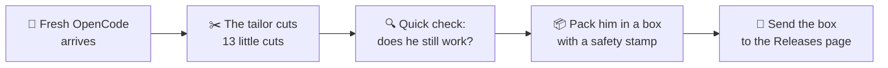

<p align="center">🇬🇧 <b>English</b> · <a href="README.id.md">🇮🇩 Bahasa Indonesia</a></p>

# 🤖✂️ The Little Tailor

### *The story of `opencode-patch`, told very, very simply*


---

## 📖 Chapter 1 — Once upon a time…

Once upon a time, there was a big, strong robot named **OpenCode**.
He helps people write computer programs. He is very smart. 🤖

But OpenCode carries **everything** in his backpack.
A hundred toy shops. A radio. A post office. A language teacher.
Most people only play with a few of his toys.
The rest just make his backpack heavy. 🎒

So a **little tailor** came.
Snip, snip. ✂️
He cut away the parts we do not need — **really cut them away**,
not hidden in a closet. Gone is gone.

This home, `opencode-patch`, is the little tailor's workshop.
It does **not** keep the robot inside.
It keeps the tailor's **list of cuts**, and tells the builder robots
at GitHub how to sew a slimmer OpenCode, again and again.

> 💡 **One-sentence version:** this repo holds small "cut recipes"
> (called *patches*). Big builder robots use them to rebuild OpenCode
> without the parts we do not want.

---

## 🎒 Chapter 2 — Before and after the diet


Same robot. Same brain. Much lighter backpack.

| | How big? |
|---|---|
| 🐘 Before (normal OpenCode) | **214.5 MB** |
| 🐜 After (our robot) | **160.1 MB** |
| 🎉 Gone | about **1 out of every 4 bites** |

---

## 🏠 Chapter 3 — What lives in this house?

Only three things live here:

| Thing | What it is, in baby words |
|---|---|
| 📋 `patches/` | The tailor's list of cuts. One file = one cut. |
| 🪄 `install.sh` | A magic spell that brings the finished robot to your computer. |
| 📜 `README.md` | This storybook you are reading right now. |

The robot himself is **not** here.
Every time we build, the builder robots fetch a fresh OpenCode
from his own home ([anomalyco/opencode](https://github.com/anomalyco/opencode)),
do the cuts, and pack him up.

---

## 🏭 Chapter 4 — How a new robot is born



In baby steps:

1. 🎁 A fresh, untouched OpenCode arrives.
2. ✂️ The tailor does his cuts, **in number order**: cut 1, cut 2, cut 3…
3. 🛑 If **one cut does not fit**, everything stops. No half-cut robots. Ever.
4. 🔍 The robot says his name out loud (`opencode --version`) to prove he is alive.
5. 📦 He is packed into a box, and the box gets a **safety stamp** (a checksum).
6. 🚀 The box is delivered to the [Releases page](../../releases) for anyone to take home.

---

## ⏰ Chapter 5 — The postman who never sleeps too long


A little postman robot checks OpenCode's home **every 6 hours** —
4 times a day, day and night. 🌞🌙

- 📭 *"A new OpenCode was born?"* → He wakes the builders.
  They sew a slim twin with the **same name tag** (like `v1.19.4`).
- 😴 *"Nothing new?"* → He goes back to sleep. No box is made twice.

That is why this workshop needs no babysitter.
New OpenCode, new slim robot — all by itself.

---

## 🪄 Chapter 6 — Bring the robot home

One magic spell. Copy, paste, done:

```sh
curl -fsSL https://raw.githubusercontent.com/azrialwork/opencode-patch/main/install.sh | bash
```

What does the spell do? Four baby steps:

1. 👀 It looks at your computer: *"Linux? Big CPU or old CPU? Arm or x64?"*
2. 🎯 It picks the right box for your computer. Old CPUs get the gentle box (the "baseline" one).
3. 🔐 It checks the box's **safety stamp**. Stamp wrong? **It refuses to open the box.**
4. 🏠 It puts the robot in his place (`/usr/local/bin`, or `~/.local/bin` if that door is locked).

Then just type `opencode` and say hello. 👋

> 🧷 Want one special robot, not the newest? Say his name:
> `bash -s -- --version v1.19.4` at the end of the spell.
> The boxes only fit **Linux** computers (the glibc kind — sorry, musl and Windows friends).

---

## ✂️ Chapter 7 — Meet the 13 cuts

Every cut takes away **one thing the robot could do before**.
Here they are, one by one. No scary words, promise. 🤞

### 1. 🏪 The giant toy fair closes
Before, the robot knew **a hundred AI shops** (OpenAI, Anthropic, Google, and many more).
Now he knows **one small free shop** — OpenCode Zen — plus **any shop you build yourself**.
Keys for the other shops? He just says *"not found."*

### 2. 🪟 No more windows
The robot had pretty **web pages** you could open in a browser.
Gone. He now lives **only in the terminal** — the black typing window.
Simple home, no windows to clean.

### 3. 🐙 The octopus goes home
There was an octopus helper that talked to **GitHub** by itself
(opening issues and pull requests on its own).
The octopus went home. Normal `git` still works fine.

### 4. 🔤 The language teacher retires
A teacher used to stand behind the robot, whispering
*"that line is wrong, this word is misspelled"* (that was LSP).
The teacher retired. The robot still writes and runs code —
he just checks his homework by running it.

### 5. 🔌 The translator plug is pulled
Other editors (like Zed) could borrow the robot's brain through a special plug (ACP).
The plug is pulled out. The robot only talks in his own home now.

### 6. 📤 No more postcards
You could send a **link to your chat** so friends could peek inside (sharing).
No more postcards. Your chats stay home, private, with you.

### 7. 🔄 The robot stops rebuilding himself
Before, the robot could **update or delete himself** with one word.
Dangerous! A stranger's new body could replace our tailor-made one.
So those words are gone. New bodies only come from **this workshop**.

### 8. 📡 The little radio is off
The robot had a radio that quietly **reported what he did** to far-away computers (telemetry).
The radio is off. What happens at home, stays at home.

### 9. 📥 No importing old diaries
There was a door for **bringing in old chats** from files (import).
The door is closed and the key is thrown away.

### 10. 🖼️ Pictures travel as they are
Pictures used to be **squeezed and resized** by a tiny photo machine (Photon) before the robot looked at them.
The machine is gone. Pictures now travel **exactly as they are**.

### 11. 🔑 No more accounts, no more bills
The free shop used to have a **cashier**: sign in, accounts, organizations, bills.
The cashier went home. The free candies are just… free.
No sign-in. No bill. Ever.

### 12. 🍬 Only the free candies stay
The shop had 130 candies. Most cost money. 💸
Now only **9 free candies** sit on the shelf.
The paid ones are not hidden under the counter — they are **not in the shop at all**.
(Candies from *your own* shop still work, of course.)

### 13. ⌨️ The extra typing room is removed
There was a spare room where a **second terminal** could live inside the robot (PTY).
But its screen hung on the web pages — and those were cut away in Chapter 7, cut number 2.
So the empty room was removed too. The robot's own hands (his Bash tool) never used that room anyway.

---

## ✅ Chapter 8 — What the robot can STILL do

Do not worry. The important things all stayed: 💪

- ✅ Chat with you in the terminal, and help you write programs
- ✅ Read, write, and fix files
- ✅ Run commands — he **asks permission first**, and reads every command carefully before running it
- ✅ Talk to **your own AI shops** (custom providers) and your own models
- ✅ Eat the **9 free candies** from the Zen shop, no account needed
- ✅ Play with **MCP toys** — but only if *you* put them in his config. No config, no toys, no noise

---

## 📏 Chapter 9 — The tailor's three promises

1. 🤞 **Real cuts only.** Nothing is "hidden". If it is on the cut list, it is *deleted* — code, data, everything.
2. 🛑 **All or nothing.** If one cut does not fit a new OpenCode, the build stops and **no robot is shipped**. A broken robot is worse than no robot.
3. 🏭 **The workshop is at GitHub.** Robots are built by GitHub's builder robots, never on the tailor's own little computer.

---

<details>
<summary>🧓 <b>Pssst… for grown-ups who want the technical bits</b> (click me)</summary>

- **Scope:** CLI only (`packages/opencode`), Linux only, **glibc** only (no musl).
- **Release assets:** `opencode-linux-x64.tar.gz`, `opencode-linux-x64-baseline.tar.gz` (no AVX2), `opencode-linux-arm64.tar.gz`, `SHA256SUMS`. Each archive holds one `opencode` binary.
- **Version tracking:** no pin — a GitHub Actions cron (`0 */6 * * *` UTC) follows the newest stable upstream `v1.x.x`; already-released versions are skipped. Manual runs accept a version override and a `force` flag.
- **Build order:** patches in `patches/` are applied in filename order **before** `bun install`, and install runs *without* `--frozen-lockfile`, so dependencies removed by a patch are never installed. Any patch that fails to apply fails the whole build — no release.
- **Basis:** upstream `v1.19.4`, commit `148842ef7cb1bc34192b3fff57d0f9721ab9c801` (the series re-bases automatically onto each new upstream `v1.x.x`).
- **Result so far:** binary 214,526,128 → 160,073,904 bytes (−25.4%).
- **The full cut list, in technical words:** see [`patches/README.md`](patches/README.md).
- **Adding a cut:** make the change in a writable upstream clone, test it, export `git diff` as the next numbered file in `patches/`, and commit it here. The next scheduled build picks it up.

</details>

---

## ⚖️ The end

Same license as mommy OpenCode: **MIT** — free to use, free to share.

*Made with ✂️ and ❤️ by the little tailor.*
*If you liked this story, come back in 6 hours — the postman might bring a new robot.* 📬
